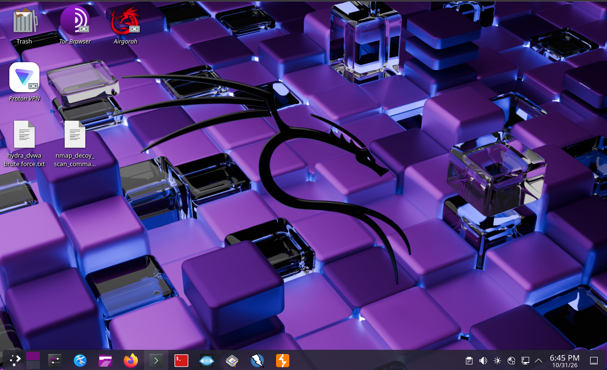
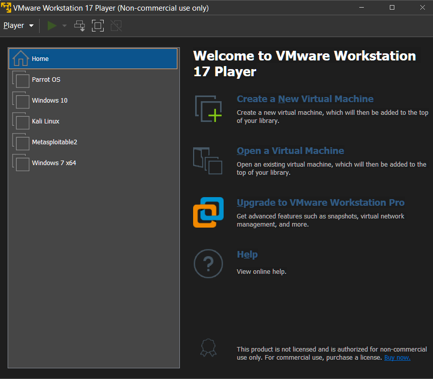
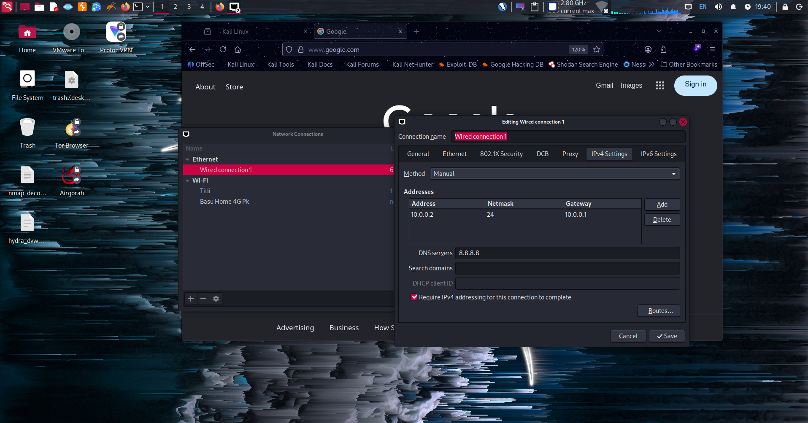

<div align="center">

# 🛡️ Cybersecurity Lab Environment Setup

### Building an Isolated Virtual Lab for Learning and Authorized Penetration Testing

**NetworkWalks Cybersecurity Internship · Batch B084J · Week 01 · Project Module 1**


</div>

---

## 📑 Table of Contents

- [Project Overview](#-project-overview)
- [Project Objectives](#-project-objectives)
- [Purpose of the Lab](#-purpose-of-the-lab)
- [Lab Architecture](#-lab-architecture)
- [Lab Configuration](#-lab-configuration)
- [Prerequisites and Tools Used](#-prerequisites-and-tools-used)
- [Step-by-Step Lab Setup Procedure](#-step-by-step-lab-setup-procedure)
- [Lab Verification](#-lab-verification)
- [Project Demonstration Video](#-project-demonstration-video)
- [Problems Encountered and Solutions](#-problems-encountered-and-solutions)
- [What I Learned](#-what-i-learned)
- [Security and Ethical Use](#-security-and-ethical-use)
- [Tools and Resources](#-tools-and-resources)
- [Author](#-author)
- [Project Information](#-project-information)

---

## 📌 Project Overview

This repository documents **Project Module 1 – Cybersecurity Lab Setup** from **Week 1** of the **NetworkWalks Cybersecurity Program (Batch B084J)**.

The goal was to build a safe, self-contained virtual lab on a **Windows 11** host using **VMware Workstation 17 Player**. A **Kali Linux** virtual machine is attached to a **custom NAT network (VMnet2)** with a **static IPv4 address**. The setup was then verified with Linux networking commands and connectivity tests.

The lab is the foundation for the hands-on security exercises that follow in the program.

<div align="center">



*Figure 1 – `01-kali-desktop.png`: The Kali Linux desktop, ready for security work. Shortcuts to Tor Browser, Airgorah and Proton VPN are visible on the desktop.*

</div>

---

## 🎯 Project Objectives

- ✅ Install and use **VMware Workstation 17 Player** as the virtualization platform on a Windows 11 host.
- ✅ Run a **Kali Linux** virtual machine as the primary security workstation.
- ✅ Create and configure a **custom NAT virtual network (VMnet2)** with subnet `10.0.0.0/24`.
- ✅ Attach the Kali VM's network adapter to the custom network.
- ✅ Assign a **static IPv4 configuration** inside Kali Linux (`10.0.0.2/24`, gateway `10.0.0.1`, DNS `8.8.8.8`).
- ✅ Verify IP configuration, routing, DNS resolution and outbound connectivity using standard Linux commands.
- ✅ Document the setup in a way that others can reproduce.

---

## 🧪 Purpose of the Lab

A dedicated lab lets a security student practice tools and techniques **without risking the host machine or any real-world system**.

| Goal | How this lab supports it |
|---|---|
| 🔒 **Isolation** | Security tools run inside a VM on a dedicated virtual network, separate from the host's normal workflow. |
| 🔁 **Repeatability** | A fixed subnet and static addressing make the lab predictable and easy to rebuild. |
| 📚 **Learning** | A real Kali Linux environment gives hands-on practice with networking and security tooling. |
| ⚖️ **Safe, legal practice** | Testing is limited to systems the author owns or is explicitly authorized to test. |

---

## 🏗️ Lab Architecture

```text
┌──────────────────────────────────────────────────────────────┐
│  Windows 11 Host  ·  VMware Workstation 17 Player            │
│                                                              │
│   ┌──────────────────────┐        ┌───────────────────────┐  │
│   │  Kali Linux VM       │  eth0  │  VMnet2 (Custom NAT)  │  │
│   │  10.0.0.2/24         ├───────►│  Subnet  10.0.0.0/24  │──┼──► Internet
│   │  DNS 8.8.8.8         │        │  Gateway 10.0.0.1     │  │
│   └──────────────────────┘        └───────────────────────┘  │
└──────────────────────────────────────────────────────────────┘
```

The VMware library on the host also contains other virtual machines (Parrot OS, Windows 10, Metasploitable2, Windows 7 x64). **They are not part of the configuration verified in this module.**

---

## ⚙️ Lab Configuration

| Component | Configuration |
|---|---|
| Hypervisor | VMware Workstation 17 Player |
| Host OS | Windows 11 |
| Security VM | Kali Linux |
| Virtual Network | Custom NAT – VMnet2 |
| Network Address | 10.0.0.0/24 |
| Kali Linux IP | 10.0.0.2/24 |
| Subnet Mask | 255.255.255.0 |
| Default Gateway | 10.0.0.1 |
| DNS Server | 8.8.8.8 |

**Kali VM hardware (from VM Settings):**

| Resource | Allocation |
|---|---|
| Memory | 8 GB |
| Processors | 6 |
| Hard Disk (SCSI) | 65 GB |
| Network Adapter | Custom (Network Walls) |
| USB Controller / Printer | Present |
| Sound Card / Display | Auto detect |

---

## 🧰 Prerequisites and Tools Used

| Category | Details |
|---|---|
| 💻 Host machine | Windows 11 PC with hardware virtualization enabled and enough RAM, CPU and disk for the VM |
| 🖥️ Hypervisor | VMware Workstation 17 Player (non-commercial use) |
| 🐉 Guest OS | Kali Linux |
| 🌐 Virtual network | VMware Virtual Network Editor, custom NAT network (VMnet2) |
| 🔧 Guest network tools | Network Connections editor, `ip`, `ifconfig`, `ping` |
| 🦊 Browser | Firefox (used to confirm web access) |

---

## 🪜 Step-by-Step Lab Setup Procedure

### 1️⃣ VMware Workstation 17 Player Setup

VMware Workstation 17 Player is installed on the Windows 11 host. The Player library lists the available virtual machines, including **Kali Linux**, which is the VM used for this module.

<div align="center">



*Figure 2 – `02-vmware-workstation.png`: VMware Workstation 17 Player home screen with the VM library (Kali Linux is the lab VM).*

</div>

> 💡 The Player home screen lists **snapshots** and **virtual network management** among the features of VMware Workstation Pro.

### 2️⃣ Kali Linux VM Setup / Import

The Kali Linux VM is added to the VMware library and sized as shown in **Virtual Machine Settings**:

- **Memory:** 8 GB
- **Processors:** 6
- **Hard disk:** 65 GB (SCSI)
- **Network adapter:** Custom (Network Walls)

To obtain Kali for VMware, use the official Kali download page (see [Tools and Resources](#-tools-and-resources)). Open the VM in VMware Player (**Open a Virtual Machine**) or create a new VM from the installer ISO.

### 3️⃣ Custom NAT Network (VMnet2) Configuration

A dedicated NAT network was configured in VMware's **Virtual Network Editor**. The **NAT Settings** dialog for **vmnet2** shows:

| Setting | Value |
|---|---|
| Network | vmnet2 |
| Subnet IP | 10.0.0.0 |
| Subnet mask | 255.255.255.0 |
| Gateway IP | 10.0.0.1 |
| Port forwarding | None configured |
| Allow active FTP | Enabled |
| Allow any Organizationally Unique Identifier | Enabled |
| UDP timeout | 30 seconds |
| Config port | 0 |
| IPv6 | Disabled |

<div align="center">


*Figure 3 – `06-vmware-network-settings.png`: NAT Settings for vmnet2 – subnet 10.0.0.0/255.255.255.0 with gateway 10.0.0.1.*

</div>

### 4️⃣ Kali Linux Network Adapter Configuration

In the Kali VM's **Virtual Machine Settings → Hardware → Network Adapter**, the adapter is set to **Custom: Specific virtual network** and attached to the custom NAT network (shown as **Network Walls (NAT)**). **Connect at power on** is enabled.

<div align="center">


*Figure 4 – `07-vmware-vm-adapter-settings.png`: Kali VM network adapter attached to the custom virtual network.*

</div>

### 5️⃣ Static IPv4 Configuration in Kali Linux

Inside Kali, the **Wired connection 1** (Ethernet) profile was edited in the Network Connections editor, under **IPv4 Settings**:

| Field | Value |
|---|---|
| Method | **Manual** |
| Address | `10.0.0.2` |
| Netmask | `24` |
| Gateway | `10.0.0.1` |
| DNS servers | `8.8.8.8` |
| Require IPv4 addressing for this connection to complete | ✅ Enabled |

The gateway matches the VMnet2 NAT gateway, and the address sits inside the `10.0.0.0/24` lab subnet.

<div align="center">



*Figure 5 – `03-kali-network-settings.png`: Static IPv4 configuration for Wired connection 1. Firefox in the background has loaded google.com.*

</div>

### 6️⃣ Network Connectivity and DNS Verification

After saving the configuration, the setup was checked from the Kali terminal with `ip addr && ifconfig` and `ping -c 4 networkwalks.com`.

- **IP configuration:** `eth0` is **UP** with `10.0.0.2/24`, netmask `255.255.255.0` and broadcast `10.0.0.255`.
- **Connectivity and DNS:** `networkwalks.com` resolved to `192.232.216.135` and all 4 ping packets were answered.

<div align="center">


*Figure 6 – `04-kali-connectivity-test ip config.png`: `ip addr` and `ifconfig` confirm `eth0` = 10.0.0.2/24, and `ping -c 4 networkwalks.com` shows 4 packets transmitted, 4 received, 0% packet loss.*

</div>

Full results are summarized in [Lab Verification](#-lab-verification).

### 7️⃣ Clean VM Snapshot / Recovery Point

> ⚠️ **Not included in this module.** No snapshot or recovery point is shown in the screenshots or recorded in the project details, so none is claimed here. VMware Workstation 17 Player also lists snapshots as a Workstation Pro feature. Backing up the VM files manually is an alternative if a recovery point is wanted later.

---

## ✅ Lab Verification

Commands run on the Kali Linux VM, with what each one verifies:

| # | Command | What it verifies | Expected result | Result in this project |
|---|---|---|---|---|
| 1 | `ip addr` | The interface has the intended static IPv4 address and is up | `eth0` is `UP` with `inet 10.0.0.2/24` | ✅ **Captured** – `eth0` UP, `10.0.0.2/24`, broadcast `10.0.0.255` |
| 2 | `ifconfig` | Netmask, broadcast and interface error counters | `netmask 255.255.255.0`, `broadcast 10.0.0.255`, no errors | ✅ **Captured** – RX/TX errors 0, dropped 0 |
| 3 | `ip route` | The default route points to the lab gateway | `default via 10.0.0.1 dev eth0` and a `10.0.0.0/24` route | 📝 Recommended check – not captured in screenshots |
| 4 | `ping -c 4 10.0.0.1` | Layer-3 reachability of the VMnet2 NAT gateway | 4 replies, 0% packet loss | 📝 Recommended check – not captured in screenshots |
| 5 | `ping -c 4 8.8.8.8` | Internet reachability by IP address (no DNS involved) | 4 replies, 0% packet loss | 📝 Recommended check – not captured in screenshots |
| 6 | `ping -c 4 networkwalks.com` | DNS resolution plus outbound connectivity | Name resolves to an IP and replies are received | ✅ **Captured** – resolved to `192.232.216.135`, 4/4 received, 0% loss, avg ≈ 340.6 ms |

```bash
# 1–2. Interface address and details
ip addr
ifconfig

# 3. Routing table (default gateway)
ip route

# 4. Gateway reachability
ping -c 4 10.0.0.1

# 5. Internet reachability without DNS
ping -c 4 8.8.8.8

# 6. DNS resolution + connectivity
ping -c 4 networkwalks.com
```

**Captured ping results (`networkwalks.com`):**

```text
4 packets transmitted, 4 received, 0% packet loss, time 3004ms
rtt min/avg/max/mdev = 316.439/340.648/399.207/33.930 ms
```

### 🔎 How to read the results

- **Test by IP and by name.** `ping 8.8.8.8` succeeding while `ping networkwalks.com` fails points to a **DNS problem**. If both fail, check the gateway and the adapter's network selection.
- **ICMP can be blocked.** Some websites and firewalls drop ping (ICMP echo) traffic even when web access works. A failed ping to a website does not prove the lab is broken. Combine ping results with DNS resolution and a real browser test.
- **Browser check.** In Figure 5, Firefox on Kali has loaded `google.com`, which supports working web access through the lab network.

---

## 🎬 Project Demonstration Video

<div align="center">
  
[](https://www.linkedin.com/feed/update/urn:li:activity:7522351531812089856/)

**Direct link:** [week1-lab-setup-demo.mp4](https://www.linkedin.com/feed/update/urn:li:activity:7522351531812089856/)

</div>

The video (about 2 minutes 45 seconds) demonstrates the completed lab setup, including:

- Booting the Kali Linux VM in VMware Workstation 17 Player
- The VMware Virtual Network Editor and the NAT settings
- Kali Linux login and desktop
- The Network Connections editor
- Firefox loading Google and a web search
- Ping tests in the Kali terminal

> 📝 **Note:** GitHub does not reliably play MP4 files inline from a README in every view. Click the preview image, the badge or the direct link above to open `week1-lab-setup-demo.mp4` in the repository file viewer, where you can also download it.

---

## 🧩 Problems Encountered and Solutions

> This section lists the practical issues a lab like this has to handle and how this configuration deals with each. Add any additional problems you personally hit during the build.

| # | Problem / Risk | Solution used in this lab |
|---|---|---|
| 1 | The VM's static IP must belong to the same subnet as the virtual NAT network, or traffic won't reach the gateway | Kali uses `10.0.0.2/24` with gateway `10.0.0.1`, matching VMnet2's `10.0.0.0/24` and its NAT gateway |
| 2 | With **Manual** IPv4, there is no DHCP to hand out a DNS server, so names won't resolve | A DNS server (`8.8.8.8`) is set explicitly in the connection profile |
| 3 | The VM must be attached to the *custom* network, not the default one | The adapter is set to **Custom: Specific virtual network** and pointed at the custom NAT network |
| 4 | Ping to a website can fail even when web access works | Connectivity is checked by IP (`8.8.8.8`), by name, and with a browser, rather than a single ping |
| 5 | Mixed lab networks can lead to confusion about which network a VM is on | Verification relies on `ip addr` and `ip route` inside the VM to confirm the actual address and gateway |

---

## 🧠 What I Learned

- 🖥️ How to organize a virtual lab in **VMware Workstation 17 Player** and size a VM's memory, CPU and disk.
- 🌐 The difference between VMware network types (Bridged, NAT, Host-only, Custom) and why a **custom NAT network** is a good fit for a lab that still needs internet access.
- 🧮 How a subnet, mask, gateway and DNS server work together, and how to set a **static IPv4 address** on Kali Linux.
- 🔍 How to read `ip addr` and `ifconfig` output, and what `ip route` shows.
- 🧪 How to **separate connectivity problems from DNS problems** by testing with an IP address and then a domain name.
- ⚖️ Why lab isolation and **authorization** matter before running any security tool.

---

## 🔐 Security and Ethical Use

> ⚠️ **This is an educational lab. Use it only for authorized security testing.**

- ✅ Use this environment only on systems and networks that **you own** or have **explicit written permission** to test.
- ❌ Do not use the tools or techniques practiced here against third-party systems, public networks or any target without authorization.
- 🔒 Keep the lab on its virtual network and avoid exposing vulnerable VMs to untrusted networks.
- 📜 Follow your local laws, your program's code of conduct and responsible-disclosure practices.
- 📚 This repository is for **learning and documentation** purposes only. The author accepts no responsibility for misuse.

---

## 🔗 Tools and Resources

| Resource | Link |
|---|---|
| 🖥️ VMware Workstation (official product page) | https://www.vmware.com/products/desktop-hypervisor/workstation-and-fusion |
| 🐉 Kali Linux (official site) | https://www.kali.org/ |
| ⬇️ Get Kali Linux | https://www.kali.org/get-kali/ |
| 📘 Kali Docs – Installing Kali as a VMware guest | https://www.kali.org/docs/virtualization/install-vmware-guest-vm/ |
| 🌐 Google Public DNS | https://developers.google.com/speed/public-dns |
| 🐧 `ip` command manual | https://man7.org/linux/man-pages/man8/ip.8.html |
| 🎓 NetworkWalks | https://networkwalks.com |

---

## 👤 Author

<div align="center">

### **Rajatava Ghosh**

🎓 Cybersecurity Intern – NetworkWalks Cybersecurity Program, Batch B084J

[](https://github.com/RaxingR)
[](https://www.linkedin.com/in/rajatava-ghosh-265aa6316/)

🐙 **GitHub:** [https://github.com/RaxingR](https://github.com/RaxingR)
💼 **LinkedIn:** [https://www.linkedin.com/in/rajatava-ghosh-265aa6316/](https://www.linkedin.com/in/rajatava-ghosh-265aa6316/)

</div>

---

## 📋 Project Information

| Field | Details |
|---|---|
| **Project Title** | Cybersecurity Lab Environment Setup |
| **Program** | NetworkWalks Cybersecurity Program |
| **Batch** | B084J |
| **Week** | 01 |
| **Module** | Project Module 1 – Cybersecurity Lab Setup |
| **Author** | Rajatava Ghosh |
| **Hypervisor** | VMware Workstation 17 Player |
| **Host OS** | Windows 11 |
| **Security OS** | Kali Linux |
| **Lab Network** | Custom VMware NAT Network (VMnet2), 10.0.0.0/24 |
| **Repository** | https://github.com/Hypo46/NETWORKWALKS-B084J-WK1-PM1-CYBERSECURITY-LAB-SETUP |
| **Status** | ✅ Completed |

---

<div align="center">

**⭐ Built for learning. Practiced ethically. ⭐**

*Week 1 · Project Module 1 · NetworkWalks Cybersecurity Internship*

</div>
